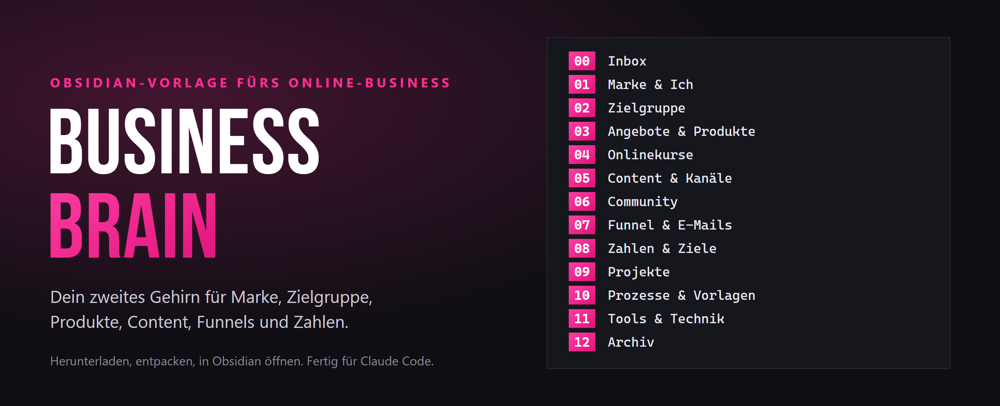

  

# Business Brain

**Die Obsidian-Vorlage fürs Online-Business.** Ein fertig eingerichtetes zweites Gehirn für alle, die digitale Produkte, Kurse oder Coachings verkaufen. Und für alle, die wollen, dass ihre KI endlich weiß, wer sie sind und für wen sie arbeiten.

Die meisten Obsidian-Vorlagen sind für Bücher, Filme, Rezepte und Reisen gemacht. Diese hier ist für dein Business. Hier landen deine Marke, deine Zielgruppe, deine Produkte, dein Content, deine Funnels und deine Zahlen, jedes an seinem festen Platz.

  <a href="https://github.com/misskittendesign-bot/business-brain-obsidian/archive/refs/heads/main.zip"><b>⬇️ Vorlage herunterladen (ZIP)</b></a>

---

## So legst du los

1. **Herunterladen.** Klick oben auf „Vorlage herunterladen“ oder hier auf der Seite auf den grünen Knopf **Code** und dann auf **Download ZIP**.
2. **Entpacken.** Zieh den Ordner an einen festen Platz auf deinem Rechner, zum Beispiel in deine Dokumente. Gib ihm gern einen schöneren Namen, etwa „Mein Business Brain“.
3. **In Obsidian öffnen.** Starte [Obsidian](https://obsidian.md) (kostenlos), klick auf **Ordner als Vault öffnen** und wähl den entpackten Ordner aus.

Fertig. Obsidian öffnet direkt die Startseite mit allem, was du für den Anfang brauchst. Plugins musst du keine installieren.

## Mit Claude Code ausfüllen lassen

Du musst die Notizen nicht allein füllen. Im Ordner liegt eine Datei `CLAUDE.md`, die Claude erklärt, wie dein Business Brain aufgebaut ist.

Öffne [Claude Code](https://claude.com/claude-code) in deinem Vault-Ordner und schreib:

> Richte mein Business Brain ein.

Claude stellt dir dann Fragen, immer nur ein, zwei auf einmal, und schreibt deine Antworten selbst in die richtigen Notizen. Zuerst deine Marke, dann deine Zielgruppe, dann deine Produkte. Erfunden wird dabei nichts. Was du nicht beantwortest, bleibt als Frage stehen.

Danach liest Claude bei jeder Aufgabe zuerst in deinem Business Brain nach. Ein Post klingt nach dir, eine Mail kennt deine Einwände, und ein Preis ist nie falsch.

## Die Ordner

Nummern vorne dran, damit die Ordner immer in derselben Reihenfolge stehen. Von *wer du bist* oben nach *was du gerade tust* unten.

| Ordner | Was hier reinkommt |
|---|---|
| **00 Inbox** | Der Zettelkasten für alles, was dir zwischendurch einfällt, dazu deine Tagesnotizen. Erst rein damit, einsortiert wird später. |
| **01 Marke & Ich** | Wer du bist und wie du klingst. Damit deine KI nach dir klingt und nicht nach dem Internet-Durchschnitt. |
| **02 Zielgruppe** | Für wen du das alles machst. Ihre Probleme, ihre Einwände und ihre Worte. |
| **03 Angebote & Produkte** | Alles, was du verkaufst, mit Preis, Versprechen und Ergebnis. |
| **04 Onlinekurse** | Die Werkstatt für deine Kurse. Konzept, Modulplan, Skripte, Workbook. |
| **05 Content & Kanäle** | Was du nach draußen gibst, sortiert nach Kanal. YouTube, Newsletter, Instagram, Blog. |
| **06 Community** | Häufige Fragen, Feedback und echte Zitate deiner Leute. Gold für Verkaufstexte. |
| **07 Funnel & E-Mails** | Der Weg vom ersten Klick bis zum Kauf. Opt-in-Seiten, Mail-Serien, Verkaufsseiten. |
| **08 Zahlen & Ziele** | Umsatz, Leads, Conversion und dein Jahresziel. |
| **09 Projekte** | Was gerade läuft, was geplant ist und was fertig ist. |
| **10 Prozesse & Vorlagen** | Deine Abläufe wie die Launch-Checkliste und alle Vorlagen für neue Notizen. |
| **11 Tools & Technik** | Womit du arbeitest und wie alles zusammenhängt. Passwörter gehören nicht hierher. |
| **12 Archiv** | Nichts löschen, nur wegräumen. Alte Launches, verworfene Ideen, alte Produkte. |

## Was schon eingerichtet ist

- **30 Startnotizen mit Leitfragen.** Keine Beispieltexte, die du erst löschen musst, sondern die Fragen, die du beantworten solltest.
- **9 Vorlagen** für Tagesnotiz, Projekt, Produkt, Lead-Magnet, Content, Newsletter, E-Mail-Serie, Kundengespräch und Wochenrückblick.
- **3 Tabellen, die sich selbst füllen.** Legst du ein Produkt, ein Projekt oder einen Content mit der passenden Vorlage an, taucht er automatisch in der Übersicht auf.
- **Eine Startseite** mit Anleitung, deinen aktuellen Projekten und deinen Produkten.
- **Fertige Einstellungen.** Neue Notizen landen in der Inbox, Bilder im Ordner Anhänge, Tagesnotizen und Vorlagen sind verbunden.
- **Eine `CLAUDE.md`**, damit Claude Code dein Business Brain versteht und darin arbeiten kann.

## Drei Gewohnheiten, die dein Gehirn schlau machen

1. **Jeden Tag eine Tagesnotiz.** Ein Klick auf das Kalendersymbol links, die Vorlage ist schon da.
2. **Einmal die Woche die Inbox leeren.** Alles an seinen Platz schieben oder ins Archiv.
3. **Fertiges immer hier speichern.** Ein guter Text, der nur im Chat steht, ist morgen weg.

---

## Von wem ist das?

Die Vorlage kommt von **Natascha von BusinessKickstart mit Natascha**. Ich helfe Menschen im deutschsprachigen Raum dabei, mit KI, klaren Strukturen und einfachen Systemen digitale Produkte zu erstellen und zu verkaufen.

Wie du dein Business Brain mit Obsidian und Claude aufbaust, zeige ich Schritt für Schritt auf meinem YouTube-Kanal.

▶️ [YouTube: BusinessKickstart mit Natascha](https://www.youtube.com/@BusinessKickstartmitNatascha)

Die Vorlage ist kostenlos für dein eigenes Business. Nimm sie, pass sie an, mach sie zu deiner. Bitte verkauf sie nicht als dein eigenes Produkt weiter.
